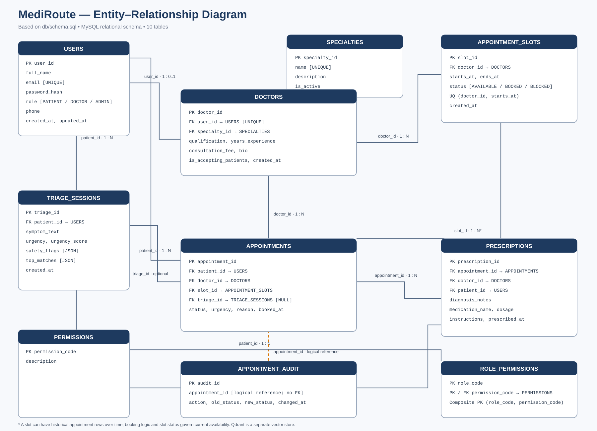

# MediRoute ER Diagram

The updated entity–relationship diagram is based on the implemented MySQL schema in `db/schema.sql`.

The diagram includes all 10 relational tables:

- `users`
- `permissions`
- `role_permissions`
- `specialties`
- `doctors`
- `appointment_slots`
- `triage_sessions`
- `appointments`
- `prescriptions`
- `appointment_audit`

**Model notes**
- Patient, doctor and administrator accounts are represented by `users`, distinguished by the `role` column.
- `doctors.user_id` is a unique foreign key to `users.user_id`.
- `appointment_slots` stores availability separately from appointments.
- `appointments.triage_id` is nullable.
- `appointment_audit.appointment_id` is a logical reference and is not enforced as a foreign key.
- `role_permissions` uses a composite primary key: (`role_code`, `permission_code`).
- Qdrant is a separate vector store and is not part of the relational ER model.
