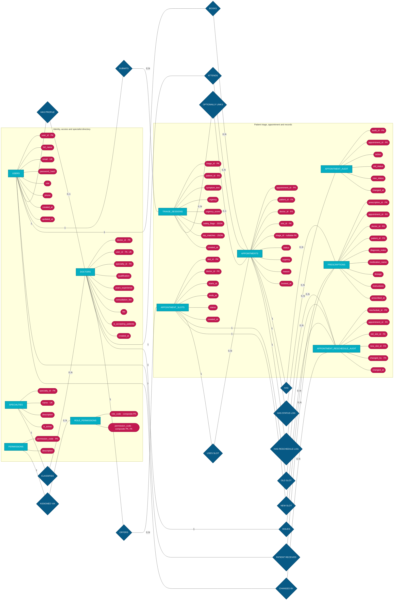

# MediRoute Entity–Relationship Diagram

This is the Chen-style ER diagram for the current MySQL implementation in `db/schema.sql`. It uses entity rectangles, relationship diamonds, attribute ovals, and cardinality labels, matching the conventional ER format used in the project reference.

## Chen ER diagram

## Cardinality and implementation notes

- **USERS–DOCTORS:** one user can have zero or one doctor profile; each doctor profile belongs to exactly one user because `doctors.user_id` is unique and non-null.
- **SPECIALTIES–DOCTORS:** one specialty can classify many doctors; each doctor references one specialty.
- **DOCTORS–APPOINTMENT_SLOTS:** one doctor can offer many slots.
- **USERS–TRIAGE_SESSIONS:** one patient can submit many triage sessions.
- **USERS–APPOINTMENTS:** one patient can book many appointments.
- **DOCTORS–APPOINTMENTS:** one doctor can be assigned many appointments.
- **APPOINTMENT_SLOTS–APPOINTMENTS:** an appointment references one slot. A slot may be referenced by multiple historical appointment rows over time after cancellation and rebooking.
- **TRIAGE_SESSIONS–APPOINTMENTS:** an appointment can have zero or one triage session. The FK is nullable and not unique, so one triage session can be referenced by multiple appointment rows.
- **APPOINTMENTS–PRESCRIPTIONS:** one appointment can have multiple prescription rows. The prescription also stores doctor and patient FKs; triggers ensure those values match the appointment.
- **APPOINTMENTS–APPOINTMENT_AUDIT:** one appointment can have multiple status audit events.
- **APPOINTMENTS–APPOINTMENT_RESCHEDULE_AUDIT:** one appointment can have multiple reschedule events. The reschedule history also references the old slot, new slot and user who made the change.
- **PERMISSIONS–ROLE_PERMISSIONS:** one permission can be assigned through multiple role-permission rows.

**RBAC note:** `ROLE_PERMISSIONS.permission_code` is an enforced FK to `PERMISSIONS.permission_code`. `ROLE_PERMISSIONS.role_code` is part of the composite PK but is not an FK to `USERS.role`; the application performs that role-code match in its permission lookup.

**Vector-store boundary:** Qdrant collection `medical_routing_v1` is separate from MySQL and is not included in this relational ER diagram.
